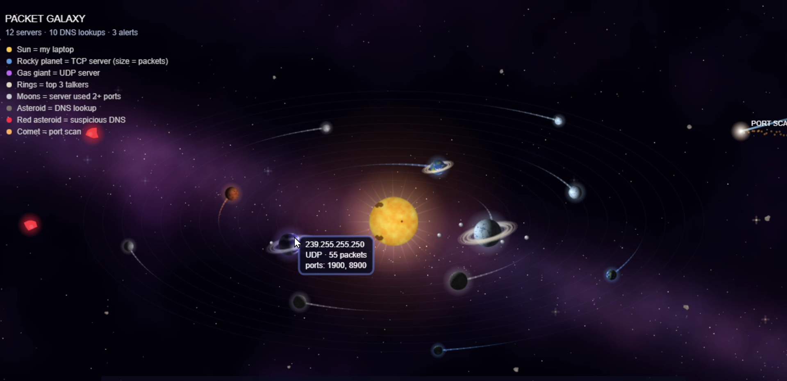

# Packet Galaxy

**My laptop's real network traffic, turned into an animated solar system, with simple threat detection built in.**



▶ **[Watch the 45-second demo](media/packet_galaxy_demo.mp4)** · 🌌 **[Open the live demo](https://m-pallvi.github.io/packet-galaxy/)** (runs on safe sample data)

---

## What it shows

| In the galaxy | In the network |
| --- | --- |
| ☀️ Sun | My laptop |
| 🪐 Planet | A server my laptop talked to (bigger = more packets) |
| Rocky planet / gas giant | TCP server / UDP server |
| Rings | The 3 busiest connections |
| Moons | A server that used 2+ different ports |
| Asteroid belt | DNS lookups |
| 🔴 Red asteroid | Suspicious DNS lookup |
| ☄️ Comet | A port scan |

Click any planet to fly to it and see its IP, protocol, packet count and ports. Scroll to zoom, `SPACE` to pause, `+` / `-` to change speed, `R` to reset.

## How it works

```
Wireshark capture (.pcapng)  ->  parser.py (Python + Scapy)  ->  galaxy.json  ->  sketch.js (p5.js)
```

1. **Capture**: record a few minutes of my own laptop's traffic in Wireshark.
2. **Parse**: `parser.py` reads every packet, groups traffic by remote server, counts packets, bytes, protocols and ports, collects DNS lookups, and runs the detection rules.
3. **Visualise**: `sketch.js` turns the JSON into a solar system. Planet surfaces, lighting, rotation and orbits are all generated in code.

## Detection rules

| Rule | How it works | MITRE ATT&CK |
| --- | --- | --- |
| **Port scan** | One host sends SYN packets to more than 20 different ports on the same target | [T1046 Network Service Discovery](https://attack.mitre.org/techniques/T1046/) |
| **Suspicious DNS** | Domain name longer than 50 characters or with more than 6 labels, a common sign of DNS tunnelling | [T1071.004 Application Layer Protocol: DNS](https://attack.mitre.org/techniques/T1071/004/) |

**Testing:** I triggered both rules myself: an `nmap -F` scan of `scanme.nmap.org` (the Nmap project's official test server) and an `nslookup` of a long random domain. Both were detected (3 alerts: 1 port scan and 2 DNS lookups).

## What I learned

- Reading traffic in Wireshark with filters like `dns` and `tcp.flags.syn == 1 && tcp.flags.ack == 0`
- How a TCP handshake and a SYN scan look on the wire. Nmap's SYN packets use a fixed window size of 1024, which is a recognisable fingerprint
- Windows adds the local network suffix (`.lan`) to DNS lookups and retries for IPv4 and IPv6, so one `nslookup` produced 8 DNS queries
- My laptop talks to antivirus and OS telemetry servers in the background even when idle
- Debugging with HTTP status codes in a server log (200 vs 404), and binding a local server to `127.0.0.1` so other devices on the Wi-Fi can't reach it

## Limitations and next steps

- **Known issue:** multicast addresses (e.g. `239.255.255.250`, used by SSDP device discovery) are currently shown as servers. Next fix: filter out multicast traffic.
- The port-scan rule counts SYNs over the whole capture, so a slow scan spread over hours would slip through. Next step: count per time window.
- Long DNS names from legitimate CDNs could cause false positives. Next step: an allow-list of known-good domains.
- Only IPv4 traffic becomes planets for now.

## Run it yourself

```bash
pip install scapy
python parser.py          # reads capture.pcapng, writes galaxy.json
python -m http.server 8000 --bind 127.0.0.1
```

Then open `http://127.0.0.1:8000`. Without your own `galaxy.json`, it loads `sample_galaxy.json`.

## Privacy

Real captures (`*.pcapng`) and real output (`galaxy.json`) are excluded by `.gitignore`. They contain the sites I visited and IP addresses. The repo only includes **sample data** using documentation-only IP ranges and `example.com` domains.

## Built with

Python · Scapy · Wireshark · Nmap · p5.js

---

Built by **Pallvi**, final-year Bachelor of Networking (Cybersecurity) student at Melbourne Institute of Technology.
